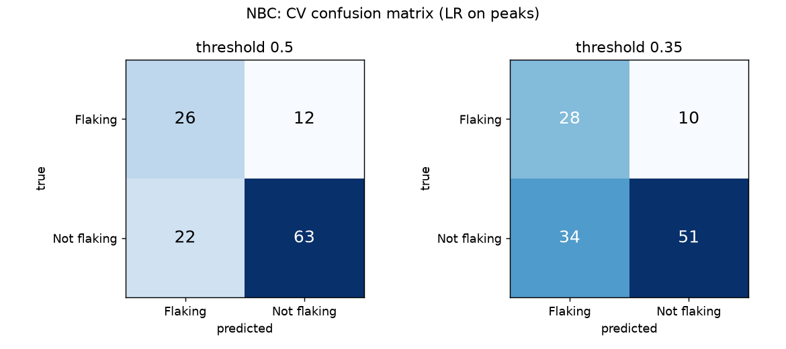
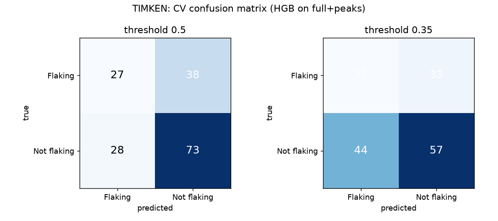

# Flaking PoC - results

**Question:** Can the tap-test FRF curve alone (0-561.25 Hz, 450 points) tell a **Flaking** bearing
from a **Not flaking** one (Not flaking = Other + Good)? We built one model per brand.

**How we tested it:**
- 5-fold StratifiedGroupKFold, grouped by bearing ID (shuffle, seed 42), with balanced class weights.
- All CV numbers below are out-of-fold: every bearing was scored by a model that never saw it.
- The 26 hold-out bearings (`tables/holdout_demo_set.csv`) were never used for training or tuning. We
  checked them once, at the end.
- IDs in `excluded_from_holdout.csv`, the Word lock file and duplicate-hash files were left out.

## 1. Data used

| Brand | Flaking | Other | Good | Total (train) | Hold-out |
|---|---|---|---|---|---|
| NBC | 38 | 65 | 20 | 123 | 13 (5 F / 5 O / 3 G) |
| TIMKEN | 65 | 77 | 24 | 166 | 13 (5 F / 5 O / 3 G) |

## 2. Main result (cross-validation, Flaking vs Not flaking)

We tried 5 feature sets (full curve, 10 Hz zones, peak features, and two combinations) with 4 models
(LR, SVM, RF, HGB). The best combination by balanced accuracy was kept for each brand.

| Brand | Best model | Features | AUC | Balanced acc. | Flaking recall | Not-flaking recall |
|---|---|---|---|---|---|---|
| NBC | Logistic regression | peaks | 0.73 | **0.71** | 0.68 | 0.74 |
| TIMKEN | Gradient boosting (HGB) | full + peaks | 0.56 | **0.57** | 0.42 | 0.72 |

These numbers use threshold 0.5. Balanced accuracy is 0.50 for a coin flip.

### Flaking bearings missed

| Brand | Threshold | Flaking missed | Flaking recall | Not-flaking recall | Balanced acc. |
|---|---|---|---|---|---|
| NBC | 0.50 | **12 of 38** | 0.68 | 0.74 | 0.71 |
| NBC | 0.35 | **10 of 38** | 0.74 | 0.60 | 0.67 |
| TIMKEN | 0.50 | **38 of 65** | 0.42 | 0.72 | 0.57 |
| TIMKEN | 0.35 | **33 of 65** | 0.49 | 0.56 | 0.53 |

Lowering the threshold to 0.35 catches only 2 more NBC and 5 more TIMKEN flaking bearings, and it
raises many more false alarms.

### Confusion matrices (threshold 0.5)

| | Predicted Flaking | Predicted Not flaking |
|---|---|---|
| **NBC - true Flaking** | 26 | 12 |
| **NBC - true Not flaking** | 22 | 63 |
| **TIMKEN - true Flaking** | 27 | 38 |
| **TIMKEN - true Not flaking** | 28 | 73 |

## 3. Comparison variants (same CV, best model per variant)

These show which questions are easier. They are for comparison only; the app uses the main model.

| Variant | Brand | Model / features | n | AUC | Balanced acc. | Positive recall | Positives missed @0.5 / @0.35 |
|---|---|---|---|---|---|---|---|
| **Flaking vs Not flaking (main)** | NBC | LR / peaks | 123 | 0.73 | 0.71 | 0.68 | 12 / 10 |
| **Flaking vs Not flaking (main)** | TIMKEN | HGB / full+peaks | 166 | 0.56 | 0.57 | 0.42 | 38 / 33 |
| Damaged (Flaking+Other) vs Good | NBC | HGB / zones+peaks | 123 | 0.85 | 0.82 | 0.93 | 7 / 7 |
| Damaged (Flaking+Other) vs Good | TIMKEN | LR / zones | 166 | 0.71 | 0.64 | 0.82 | 25 / 14 |
| Flaking vs Good (Other left out) | NBC | HGB / full+peaks | 58 | 0.96 | 0.86 | 0.92 | 3 / 3 |
| Flaking vs Good (Other left out) | TIMKEN | LR / full+peaks | 89 | 0.75 | 0.72 | 0.86 | 9 / 7 |
| Flaking-only labels vs Not flaking | NBC | LR / peaks | 107 (22 pos.) | 0.76 | 0.65 | 0.50 | 11 / 5 |
| Flaking-only labels vs Not flaking | TIMKEN | LR / full | 134 (33 pos.) | 0.57 | 0.61 | 0.39 | 20 / 18 |

**What this tells us:**
- Separating a flaking bearing from a **Good** one is much easier (NBC AUC 0.96, TIMKEN 0.75).
- The hard part is the **Other** class (other defects). Their curves look much like flaking curves.
- So the FRF does carry damage information, but not much that is specific to flaking, especially for
  TIMKEN.

## 4. Important frequencies and features

Importance is grouped permutation importance: the drop in out-of-fold AUC when that feature (or 10 Hz
zone) is shuffled.

| Rank | NBC feature | AUC drop | TIMKEN feature | AUC drop |
|---|---|---|---|---|
| 1 | Peak 75-95 Hz: shift vs Good | 0.067 | Zone 100-110 Hz | 0.026 |
| 2 | Peak 425-470 Hz: level vs Good | 0.060 | Zone 110-120 Hz | 0.024 |
| 3 | Peak 150-170 Hz: shift vs Good | 0.050 | Zone 60-70 Hz | 0.020 |
| 4 | Peak 425-470 Hz: area | 0.050 | Zone 540-550 Hz | 0.015 |
| 5 | Peak 75-95 Hz: frequency | 0.030 | Zone 10-20 Hz | 0.013 |
| 6 | Peak 425-470 Hz: frequency | 0.028 | Zone 560-570 Hz | 0.012 |
| 7 | Peak 18-28 Hz: level vs Good | 0.027 | Zone 170-180 Hz | 0.011 |
| 8 | Peak 280-300 Hz: shift vs Good | 0.026 | Peak 150-170 Hz: shift | 0.009 |

- **NBC:** the model uses **peak shifts** (75-95 Hz and 150-170 Hz) and the **425-470 Hz peak** (its
  level, area and frequency). That makes physical sense: damage changes stiffness, which moves and
  damps the resonances.
- **TIMKEN:** every importance is small and spread over many zones. There is no clear signal.

Full tables: `tables/importance_NBC.csv`, `tables/importance_TIMKEN.csv`.

## 5. Hold-out check (26 bearings, never seen in training)

The verdict is FLAKING when the flaking probability is above 0.5. In the app, a probability between 35%
and 65% shows as **UNSURE**. Confidence = max(p, 1-p).

| Brand | Correct | Balanced acc. | Flaking found (@0.5) | Flaking found (@0.35) | Not flaking correct | UNSURE in app |
|---|---|---|---|---|---|---|
| NBC | 11 of 13 | 0.80 | 3 of 5 | 4 of 5 | 8 of 8 | 4 |
| TIMKEN | 5 of 13 | 0.39 | 2 of 5 | 2 of 5 | 3 of 8 | 1 |

### NBC hold-out

| Bearing ID | Folder class | True label | Predicted | P(flaking) | Confidence | Result |
|---|---|---|---|---|---|---|
| 22901 | Flaking | Flaking | Flaking | 67% | 67% | correct |
| 57766 | Flaking | Flaking | Flaking | 68% | 68% | correct |
| 77677 | Flaking | Flaking | Flaking | 66% | 66% | correct |
| 223264 | Flaking | Flaking | Not flaking | 48% | 52% | **missed** (UNSURE in app) |
| 212920 | Flaking | Flaking | Not flaking | 8% | 92% | **missed** |
| 52578 | Other | Not flaking | Not flaking | 33% | 67% | correct |
| 229507 | Other | Not flaking | Not flaking | 5% | 95% | correct |
| 41333 | Other | Not flaking | Not flaking | 41% | 59% | correct (UNSURE in app) |
| 230179 | Other | Not flaking | Not flaking | 1% | 99% | correct |
| 19526 | Other | Not flaking | Not flaking | 36% | 64% | correct (UNSURE in app) |
| 219060 | Good | Not flaking | Not flaking | 16% | 84% | correct |
| 225839 | Good | Not flaking | Not flaking | 2% | 98% | correct |
| 217792 | Good | Not flaking | Not flaking | 47% | 53% | correct (UNSURE in app) |

### TIMKEN hold-out

| Bearing ID | Folder class | True label | Predicted | P(flaking) | Confidence | Result |
|---|---|---|---|---|---|---|
| 277022 | Flaking | Flaking | Flaking | 85% | 85% | correct |
| 36008 | Flaking | Flaking | Flaking | 73% | 73% | correct |
| 279760 | Flaking | Flaking | Not flaking | 23% | 77% | **missed** |
| 572831 | Flaking | Flaking | Not flaking | 30% | 70% | **missed** |
| 380799 | Flaking | Flaking | Not flaking | 33% | 67% | **missed** |
| 565583 | Other | Not flaking | Not flaking | 32% | 68% | correct |
| 105828 | Other | Not flaking | Not flaking | 6% | 94% | correct |
| 120697 | Other | Not flaking | Not flaking | 39% | 61% | correct (UNSURE in app) |
| 646441 | Other | Not flaking | Flaking | 73% | 73% | **false alarm** |
| 642353 | Other | Not flaking | Flaking | 84% | 84% | **false alarm** |
| 274303 | Good | Not flaking | Flaking | 97% | 97% | **false alarm** |
| 838761 | Good | Not flaking | Flaking | 66% | 66% | **false alarm** |
| 400252 | Good | Not flaking | Flaking | 85% | 85% | **false alarm** |

All three TIMKEN Good bearings in the hold-out were flagged as flaking, with high confidence. With only
13 bearings per brand, the hold-out numbers are noisy. Read them together with the CV numbers.

Full table: `tables/holdout_results.csv`.

## 6. Conclusion (honest)

1. **NBC works fairly well.** CV balanced accuracy is 0.71 and hold-out is 0.80, but it still misses about
   1 flaking bearing in 3. It is a useful screening hint, not a decision tool.
2. **TIMKEN does not work.** CV AUC is 0.56 and hold-out balanced accuracy is 0.39, which is close to
   chance. Its features show no clear signal, so the FRF alone does not separate TIMKEN flaking.
3. The curve clearly shows **damaged vs good** (NBC AUC 0.85, Flaking vs Good 0.96), but not **flaking vs
   other defects**. More flaking-specific labels, or more tap points or channels, are needed before
   this could be relied on.
